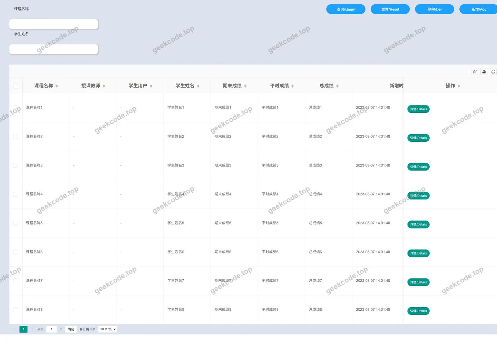
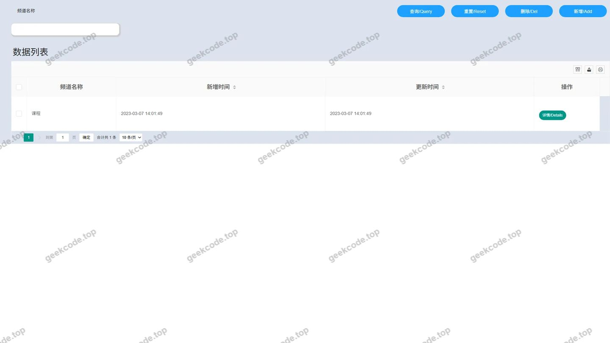
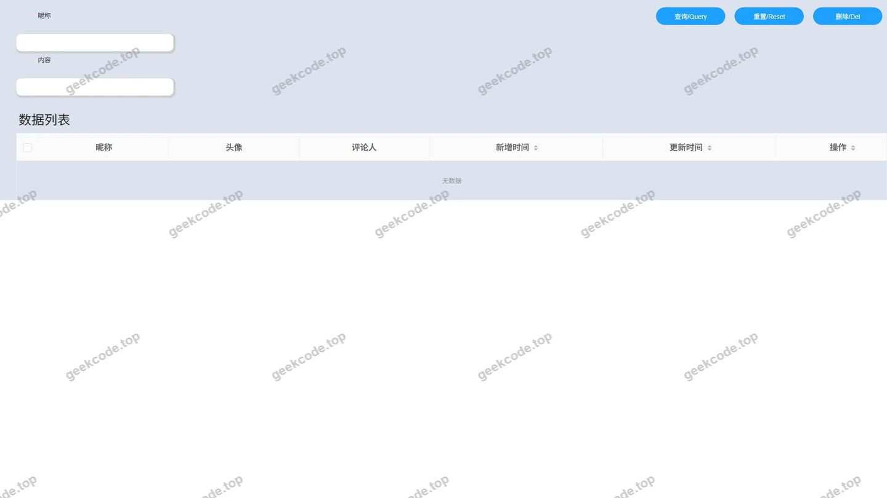
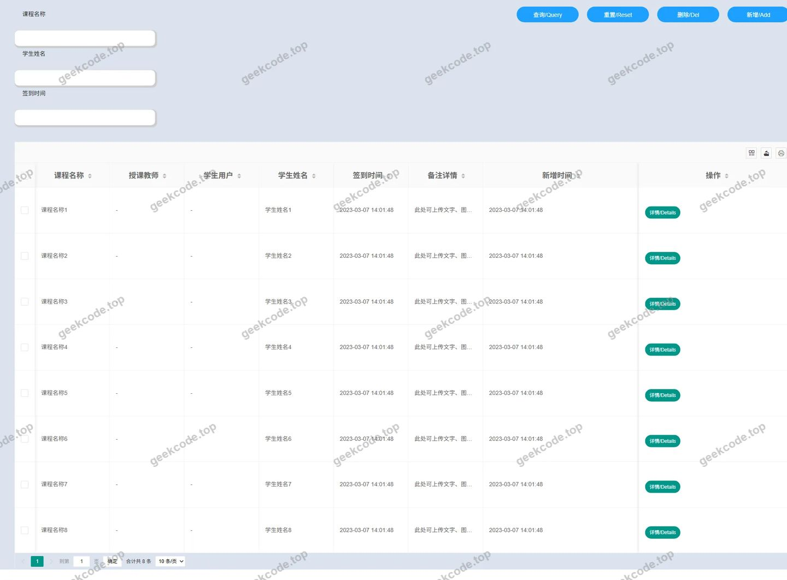
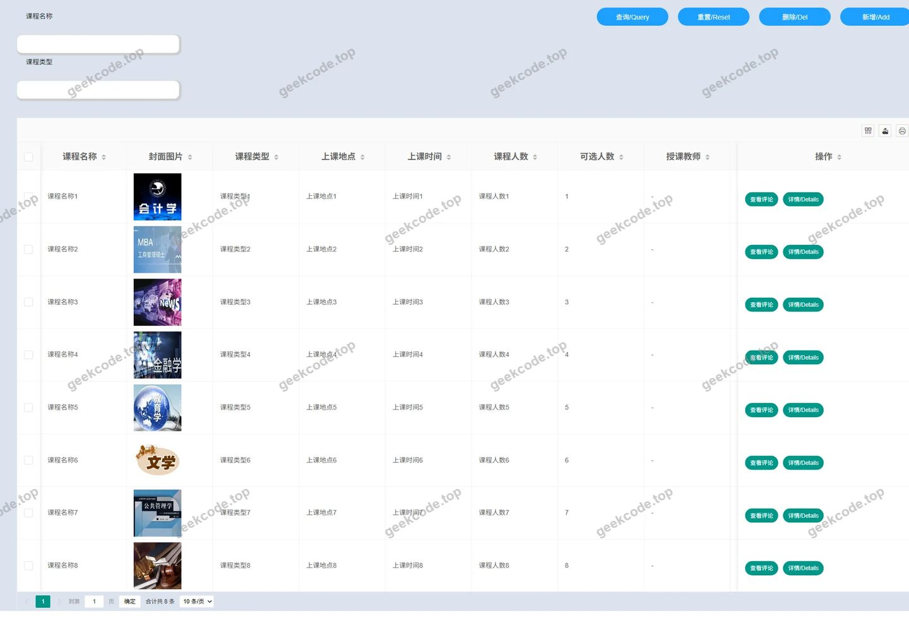
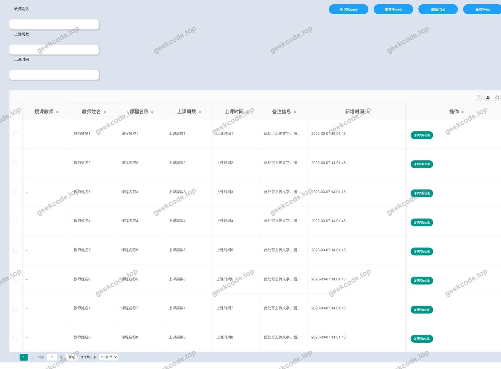

# SSM学生选课管理系统

> 🎓 **计算机毕业设计 · SSM学生选课管理系统**
>
> 本仓库只放**项目介绍 + 运行截图**（截图是站点带水印的原图，存在仓库 `images/` 里）。
>
> 👉 **完整可运行源码 / 数据库脚本 / 部署文档：[点我获取](https://geekcode.top/archives/SSM%E5%AD%A6%E7%94%9F%E9%80%89%E8%AF%BE%E7%AE%A1%E7%90%86%E7%B3%BB%E7%BB%9F?utm_source=github)**
>
> 💬 咨询微信：**ir9372**　|　🌐 更多项目：[极客代码 geekcode.top](https://geekcode.top/?utm_source=github)
>
> 📌 项目详情页：<https://geekcode.top/archives/SSM%E5%AD%A6%E7%94%9F%E9%80%89%E8%AF%BE%E7%AE%A1%E7%90%86%E7%B3%BB%E7%BB%9F?utm_source=github>

<table><td width="230" align="center"> <b>扫码加微信 ir9372</b></td><td valign="middle">📦 源码 = 项目介绍 + 全部运行截图 + 数据库 + 部署文档 👉 点上方任意截图，直接跳到 <b>极客代码 geekcode.top</b> 详情页</td></table>

---

<h1>SSM学生选课管理系统</h1>
<h2>项目概述</h2>

本项目名为“SSM学生选课管理系统”，旨在构建一个基于 Java Web 技术栈的学生选课管理平台。尽管项目名称中包含“SSM”（Spring + Spring MVC + MyBatis）字样，但根据实际依赖配置分析，该项目核心采用 <strong>Spring Boot</strong> 框架进行快速开发，底层数据持久化依赖 MySQL 数据库。

系统主要面向高校教务管理场景，核心功能涵盖用户身份认证、课程信息展示及基础的数据管理能力。通过引入 <code>jakarta.persistence-api</code>，项目采用了 JPA（Java Persistence API）标准进行对象关系映射，简化了数据库操作逻辑。前端页面包含登录界面、轮播图展示区以及多个数据表格视图（如评论表等），用于呈现选课状态或相关反馈信息。适用人群主要为需要处理选课业务的管理员及普通用户，技术架构侧重于后端服务的稳定性与数据交互的高效性。

<h2>技术架构</h2>
<h3>1. 后端架构</h3>

项目采用 <strong>Spring Boot</strong> 作为核心应用框架，利用其自动配置特性简化部署流程。具体技术选型如下：

<ul>
<li><strong>Web 层</strong>：使用 <code>javax.servlet-api</code> 和 <code>jstl</code> 处理 HTTP 请求与服务器端页面渲染。虽然未明确列出 Controller 代码，但 Servlet API 的存在表明系统具备标准的 Web 请求处理能力。</li>
<li><strong>持久层</strong>：依赖 <code>mysql-connector-java</code> 连接 MySQL 数据库，并通过 <code>jakarta.persistence-api</code> 实现 ORM（对象关系映射）。这意味着项目可能使用了 Hibernate 或 Spring Data JPA 来管理实体类与数据库表的映射关系。</li>
<li><strong>工具组件</strong>：</li>
<li><code>lombok</code>：用于简化 POJO 类的 getter/setter/constructor 编写，提高代码整洁度。</li>
<li><code>fastjson</code>：阿里巴巴开源的 JSON 解析库，用于前后端数据交换及配置文件解析。</li>
<li><code>commons-fileupload</code> &amp; <code>commons-io</code>：提供文件上传与 IO 流处理能力，支持头像或课件等资源的管理。</li>
</ul>
<h3>2. 数据库设计要点</h3>

基于截图中的“comments表”及其他数据表格视图，推测数据库结构包含以下核心要素：

<ul>
<li><strong>用户表</strong>：存储管理员、教师或学生的基本信息及凭证。</li>
<li><strong>课程/选课表</strong>：记录课程详情及学生选课关联数据。</li>
<li><strong>评论表 (Comments)</strong>：用于存储用户对课程或系统的反馈信息，对应截图中的 comments 表视图。</li>
<li><strong>其他业务表</strong>：截图中出现的多个“表”视图暗示存在多张业务数据表，可能涉及公告、日志或统计信息。</li>
</ul>
<h3>3. 测试与构建</h3>
<ul>
<li>集成 <code>junit</code> 单元测试框架，确保核心业务逻辑的正确性。</li>
</ul>
<h2>功能模块</h2>

根据提供的截图列表及路由信息缺失的情况，现有可见的功能模块主要集中在前端展示与基础数据维护层面。由于未提供具体的后台路由定义，以下模块划分严格基于截图内容推导：

<h3>1. 用户认证模块</h3>
<ul>
<li><strong>登录页面</strong>：对应截图“页面-登录”。提供用户身份验证入口，输入账号密码后进入系统主界面。这是所有后续功能访问的前置条件。</li>
</ul>
<h3>2. 首页展示模块</h3>
<ul>
<li><strong>轮播图展示</strong>：对应截图“页面-轮播图”。位于系统首页顶部，用于展示重要通知、热门课程推荐或校园活动图片，提升界面视觉体验与信息传达效率。</li>
</ul>
<h3>3. 数据管理模块</h3>
<ul>
<li><strong>通用数据表格视图</strong>：对应多个“页面-表”截图。此类界面通常以表格形式展示结构化数据，如课程列表、学生名单、选课记录等。支持数据的浏览、检索及可能的增删改查操作（具体操作权限取决于后端接口定义）。</li>
<li><strong>评论管理视图</strong>：对应“页面-comments表”截图。专门用于展示和管理用户的评论内容，可能包含评论时间、作者、内容及回复状态等信息，便于管理员监控舆情或教学反馈。</li>
</ul>

<em>(注：根据现有信息无法确定是否存在独立的“前台用户端”与“后台管理端”物理隔离，上述模块统称为系统可见功能界面。)</em>

<h2>用户角色与权限</h2>

由于项目中未明确提供 RBAC（基于角色的访问控制）的具体配置代码或菜单权限树，且缺少前后台路由的详细定义，<strong>根据现有信息无法确定</strong>具体的角色划分及其详细权限矩阵。

然而，基于“SSM学生选课管理系统”的业务常识及截图中的功能形态，可推断系统至少包含以下潜在角色模型（仅为理论推导，非源码实证）：

<ol>
<li><strong>管理员/教务人员</strong>：</li>
</ol>
<ul>
<li><strong>可访问功能</strong>：全量数据表格视图、评论管理视图、轮播图配置、用户登录鉴权后台。</li>
<li><strong>权限描述</strong>：负责系统基础数据维护，审核或删除不当评论，发布首页轮播图信息。</li>
</ul>
<ol start="2">
<li><strong>普通用户（学生/教师）</strong>：</li>
</ol>
<ul>
<li><strong>可访问功能</strong>：登录页面、查看个人相关的选课数据表格、提交评论。</li>
<li><strong>权限描述</strong>：仅能查看与自己相关的数据，无权修改全局配置或其他用户数据。</li>
</ul>

<em>(再次强调：以上角色权限描述为基于行业标准的推测，因源码上下文未包含 Security 配置或权限注解，无法给出确切的权限边界。)</em>

<h2>项目特色与创新点</h2>
<ol>
<li>
<strong>轻量化数据持久化方案</strong>：
   项目摒弃了传统 SSM 架构中复杂的 XML 配置文件，转而采用 Spring Boot 结合 Jakarta Persistence API (JPA) 的模式。这种组合极大地减少了样板代码，开发者只需定义实体类即可自动生成大部分 CRUD SQL 语句，提升了开发效率与维护性。

</li>
<li>
<strong>丰富的辅助工具集成</strong>：
   引入了 <code>Lombok</code> 彻底消除了 Getter/Setter 冗余代码，使业务逻辑更清晰；同时集成 <code>FastJSON</code> 和 <code>Commons-FileUpload</code>，使得系统在处理复杂 JSON 数据交互和大文件上传场景时具备良好的扩展性和性能表现。

</li>
<li>
<strong>直观的可视化数据管理</strong>：
   通过多个专门的“表”视图和“comments”视图，系统将原本抽象的数据库记录转化为可视化的表格界面。这种设计降低了非技术人员（如教务老师）的操作门槛，使其能够直观地监控选课数据和用户反馈，无需直接面对 SQL 语句。

</li>
</ol>
<h2>部署环境</h2>

为确保“SSM学生选课管理系统”正常运行，需准备以下软件环境：

<table>
<thead>
<tr>
<th align="left">组件</th>
<th align="left">版本要求/说明</th>
<th align="left">备注</th>
</tr>
</thead>
<tbody><tr>
<td align="left"><strong>JDK</strong></td>
<td align="left">Java 8 或以上</td>
<td align="left">建议 JDK 1.8 或 JDK 11，需兼容 Spring Boot 版本及 Jakarta EE 规范。</td>
</tr>
<tr>
<td align="left"><strong>MySQL</strong></td>
<td align="left">5.7 或 8.0+</td>
<td align="left">需创建对应的数据库实例，并导入初始化 SQL 脚本（如有）。</td>
</tr>
<tr>
<td align="left"><strong>Maven</strong></td>
<td align="left">3.6+</td>
<td align="left">用于依赖管理和项目构建，需配置阿里云镜像以加速下载。</td>
</tr>
<tr>
<td align="left"><strong>Tomcat</strong></td>
<td align="left">内置或独立</td>
<td align="left">Spring Boot 默认内嵌 Tomcat，无需单独安装；若打包为 WAR 则需外部 Tomcat。</td>
</tr>
<tr>
<td align="left"><strong>IDE</strong></td>
<td align="left">IntelliJ IDEA / Eclipse</td>
<td align="left">推荐 IDEA，对 Lombok 插件支持较好。</td>
</tr>
</tbody></table>

<strong>启动步骤简述：</strong>

<ol>
<li>修改 <code>application.properties</code> 或 <code>application.yml</code> 中的 MySQL 连接地址、用户名和密码。</li>
<li>执行 Maven 命令 <code>mvn clean package</code> 编译项目。</li>
<li>运行生成的 jar 包或在 IDE 中启动主类（Main Class）。</li>
<li>浏览器访问 <code>http://localhost:8080/login</code>（假设默认端口）进行测试。</li>
</ol>
<h2>六、功能模块截图</h2>
<h3>后台管理端</h3>
<h4>页面-登录</h4>

<h4>页面-轮播图</h4>

<h4>页面-表</h4>

<h4>页面-comments表</h4>

<h4>页面-表</h4>

<h4>页面-comments表</h4>

<h4>页面-表</h4>

<h4>页面-表</h4>

---

## 获取完整源码

| 项目 | 说明 |
| --- | --- |
| 项目名 | SSM学生选课管理系统 |
| 运行截图 | 本文 8 张（站点带水印原图，仓库 `images/` 目录） |
| 完整源码 | [https://geekcode.top/archives/SSM%E5%AD%A6%E7%94%9F%E9%80%89%E8%AF%BE%E7%AE%A1%E7%90%86%E7%B3%BB%E7%BB%9F?utm_source=github](https://geekcode.top/archives/SSM%E5%AD%A6%E7%94%9F%E9%80%89%E8%AF%BE%E7%AE%A1%E7%90%86%E7%B3%BB%E7%BB%9F?utm_source=github) |
| 咨询微信 | **ir9372**（备注：jingpin-yuanma） |
| 更多项目 | [极客代码 geekcode.top](https://geekcode.top/?utm_source=github) |

> 需要源码、部署、改配置、跑不起来等问题，加微信 ir9372 沟通，说明项目名即可。
